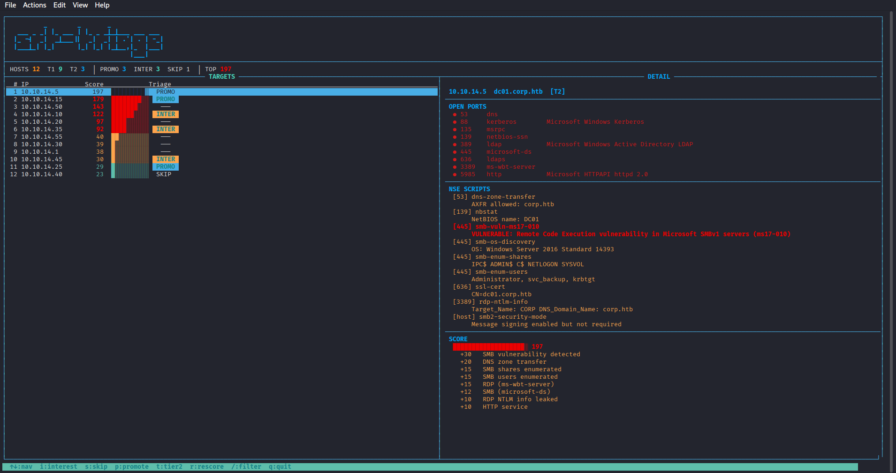
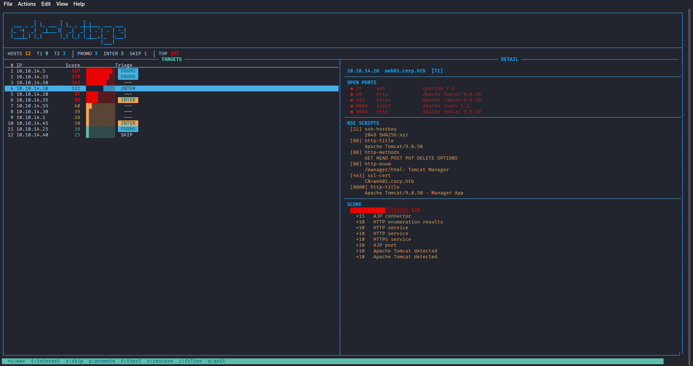

# srt-triage

**Host Triage & Ranking Tool** — a curses TUI that scans networks, parses nmap XML output, and ranks hosts by lead-scoring signals so you attack the highest-value targets first.

```
         _        _       _
  ___ _ _| |_ ___ | |_ _ _|_|___ ___ ___
 |_ -|  _|  _|___||  _|  _| | .'| . | -_|
 |___|_| |_|      |_| |_| |_|__,|_  |___|
                                |___|
```



*Ranked host list with score bars, triage badges, and live detail panel showing ports, NSE scripts, and score breakdown.*



*Tomcat host selected — AJP connector, exposed Manager app, full script output and scoring breakdown.*

## Why

Most recon tools blast every target equally and dump flat output. In a real engagement you need to **prioritize** — the Domain Controller with EternalBlue matters more than the mail server running Postfix.

srt-triage solves this with:

1. **Two-tier scanning** — Tier 1 does a fast curated-port sweep. Only hosts you promote get the full Tier 2 (`-p-`) scan. No wasted time.
2. **Lead scoring** — 95 configurable signals score hosts by what nmap actually finds: NSE vuln scripts, exposed services, dangerous ports, product versions. High score = high priority.
3. **Full NSE preservation** — Uses nmap `-oX` (XML), not `-oG`. Every script output is parsed, stored, and searchable.
4. **Interactive triage** — Curses TUI lets you review, tag, promote, and filter hosts live. No switching between terminal tabs and spreadsheets.

## Quick Start

```bash
git clone https://github.com/tm686/srt-triage.git
cd srt-triage
./install.sh          # checks deps, installs missing tools
python3 srt_triage.py 10.0.0.0/24
```

## Installation

### Requirements

- **Python 3.10+** (stdlib only — zero pip dependencies)
- **nmap** — required for service/script scanning
- **rustscan** — required for fast port discovery

### Optional Tools

| Tool | Used For |
|------|----------|
| `httpx` | HTTP probing (future use) |
| `searchsploit` | Exploit lookup (future use) |
| `ffuf` | Directory fuzzing (future use) |

### Install

```bash
# Automated (Kali/Debian)
chmod +x install.sh
./install.sh

# Manual
sudo apt install nmap rustscan
python3 srt_triage.py --help
```

The tool is pure Python stdlib — no virtual environments, no `pip install`, no internet required after cloning. Designed for offline VDI/VM deployment.

## Usage

### Basic Scan

```bash
# Scan a /24 — runs Tier 1 (rustscan + nmap on curated ports), then opens TUI
python3 srt_triage.py 10.0.0.0/24

# Multiple targets
python3 srt_triage.py 10.0.0.1 10.0.0.2 192.168.1.0/24

# Targets from file (one IP/CIDR per line)
python3 srt_triage.py targets.txt
```

### Scope Enforcement

```bash
# Use a scope file to restrict scanning
python3 srt_triage.py 10.0.0.0/16 --scope scope.json
```

Scope file format:
```json
[
  {"value": "10.0.0.0/24", "type": "ip_range", "direction": "in"},
  {"value": "10.0.0.99",   "type": "ip",       "direction": "out"}
]
```

Anything not matched by an `in` rule is rejected. `out` rules always take priority (exclusions).

### Resume Previous Session

```bash
# Skip scanning, load existing database, go straight to TUI
python3 srt_triage.py 10.0.0.0/24 --skip-scan --db srt_triage.db
```

### All Options

```
python3 srt_triage.py [targets...] [options]

positional:
  targets              IP, CIDR, or file containing targets

options:
  --scope FILE         Scope file (JSON) — restricts which IPs get scanned
  --db FILE            SQLite database path (default: srt_triage.db)
  --config-dir DIR     Config directory (default: config/)
  --skip-scan          Don't scan, load existing DB and open TUI
  -v, --verbose        Write debug logs to srt_triage.log
```

## How It Works

### Architecture

```
Input (CIDRs / IPs / file)
  │
  ├─ scope.py validates targets against in/out scope rules
  │
  ├─ Tier 1: rustscan (curated ~150 ports) → finds open ports per host
  │    └─ nmap -sC -sV -oX (only open ports) → XML output
  │         └─ nmap_xml.py parses XML → hosts, ports, services, NSE scripts
  │              └─ scorer.py evaluates 95 signals → ranked host list
  │                   └─ db.py stores everything in SQLite
  │
  └─ TUI displays ranked hosts ← you triage here
       │
       ├─ Mark hosts: interesting / skip / promote
       │
       └─ Tier 2: promoted hosts get nmap -p- -sC -sV -oX (full 65535)
            └─ Re-parse, re-score, update display
```

### Tier 1 (Fast Sweep)

1. **rustscan** blasts ~150 curated high-value ports across all targets
2. For each host with open ports, **nmap** runs `-sC -sV -oX` on just those ports
3. XML output is parsed — every port, service, product, version, and NSE script is extracted
4. Each host is scored against 95 signals and ranked

This takes minutes, not hours. You only scan ports that are actually open.

### Tier 2 (Deep Scan)

When you promote a host in the TUI, Tier 2 runs:
- `nmap -p- -sC -sV -oX` — full 65535 port scan with scripts
- Results merge with existing data, score updates live

Only run this on hosts worth the time investment.

### Lead Scoring

Every host is scored by matching nmap results against signals defined in `config/lead_signals.json`. Signal types:

| Type | What It Matches | Example |
|------|----------------|---------|
| `nse_script` | NSE script ID (glob) | `smb-vuln-*` → +30 |
| `service` | Service name | `ms-sql` → +15 |
| `port` | Open port number | `2375` (Docker) → +20 |
| `product_regex` | Product string (regex) | `vsftpd\s+2\.3\.4` → +30 |

High score = more attack surface / more vulns = triage first.

Example breakdown for a Domain Controller scoring 197:
```
+30  SMB vulnerability detected (ms17-010)
+20  DNS zone transfer
+15  SMB shares enumerated
+15  SMB users enumerated
+15  RDP (ms-wbt-server)
+12  SMB (microsoft-ds)
+10  RDP NTLM info leaked
...
```

### Scoring Philosophy

- **Vulnerability scripts** (smb-vuln-*, heartbleed, shellshock) → highest scores (25-35)
- **Dangerous access** (empty passwords, anon FTP, exposed Docker API) → high (20-30)
- **Information disclosure** (NTLM info, zone transfer, enumerable shares) → medium (10-20)
- **Service presence** (HTTP, RDP, SMB running) → low baseline (5-15)
- **Product detection** (old IIS, vsftpd 2.3.4, Jenkins) → context-dependent (5-30)

Scores stack — a host with SMB vulns + RDP + MSSQL + empty passwords will rank far above a clean web server.

## TUI Controls

```
┌──────────────────────────────────────────────────────────────────────┐
│  srt-triage ASCII logo                                               │
├──────────────────────────────────────────────────────────────────────┤
│ HOSTS 24  T1 20  T2 4  │ PROMO 4  INTER 6  SKIP 3  │ TOP 197      │
├──────── TARGETS ────────┬──────────── DETAIL ────────────────────────┤
│  1 10.0.0.5    197 ████ │  10.0.0.5  dc01.corp.htb  [T2]           │
│  2 10.0.0.15   179 ███▓ │  OPEN PORTS                               │
│  3 10.0.0.50   143 ███░ │  ● 445  microsoft-ds                      │
│  ...                    │  NSE SCRIPTS                               │
│                         │  [445] smb-vuln-ms17-010                   │
│                         │       VULNERABLE: Remote Code Execution    │
│                         │  SCORE  ████████████████ 197               │
│                         │    +30  SMB vulnerability detected         │
└─────────────────────────┴────────────────────────────────────────────┘
  ↑↓:nav  i:interest  s:skip  p:promote  t:tier2  r:rescore  q:quit
```

| Key | Action |
|-----|--------|
| `j` / `k` or `↑` / `↓` | Navigate host list |
| `i` | Mark host as **interesting** |
| `s` | Mark host as **skip** (dims it) |
| `p` | **Promote** host to Tier 2 |
| `t` | Launch Tier 2 scan on all promoted hosts |
| `r` | Re-score all hosts against current signals |
| `/` | Filter hosts by IP, hostname, or triage state |
| `g` / `G` | Jump to top / bottom of list |
| `PgUp` / `PgDn` | Page through list |
| `h` / `l` | Scroll detail panel |
| `q` | Quit |

### Color Scheme

- **Red** — Critical: high-scoring hosts with vulns, dangerous services
- **Yellow** — Medium: moderate attack surface
- **Green** — Low: minimal findings
- **Cyan** — Promoted hosts (queued for Tier 2)
- **Dim** — Skipped hosts

## Configuration

All config lives in `config/`. Edit these to customize for your environment:

### `config/ports.json`
Curated list of ~150 high-value ports for Tier 1. Add or remove ports based on your target environment. Each entry has port number, service name, and category.

### `config/lead_signals.json`
95 scoring signals. Add your own — for example, if you're targeting a Java shop:
```json
{"type": "product_regex", "match": "Apache Struts", "score": 25, "label": "Apache Struts detected"}
```

### `config/tiers.json`
Scan parameters for each tier — nmap flags, timeouts, rustscan batch sizes.

### `config/paths.json`
Binary paths for offline deployment where tools aren't in standard PATH.

## Database

All data persists in SQLite (`srt_triage.db` by default). Tables:

- **hosts** — IP, hostname, tier, triage state
- **ports** — port details with service/product/version per host
- **scripts** — full NSE script output per port
- **host_scripts** — host-level NSE scripts
- **scores** — scoring history with signal breakdowns
- **scans** — scan execution log

You can query the database directly:
```bash
sqlite3 srt_triage.db "SELECT ip, total_score FROM hosts h JOIN scores s ON h.id=s.host_id ORDER BY total_score DESC"
```

## Project Structure

```
srt-triage/
├── srt_triage.py          # Entry point — argparse, scan, TUI launch
├── install.sh             # Dependency checker / installer
├── config/
│   ├── paths.json         # Tool binary paths
│   ├── ports.json         # Curated port list (~150 ports)
│   ├── lead_signals.json  # 95 scoring signals
│   └── tiers.json         # Tier 1/2 scan parameters
├── lib/
│   ├── __init__.py
│   ├── scope.py           # Scope enforcement (ipaddress + regex)
│   ├── tool_check.py      # Tool availability checker
│   ├── scanner.py         # Scan orchestration (rustscan + nmap)
│   ├── nmap_xml.py        # nmap XML parser (xml.etree)
│   ├── scorer.py          # Lead scoring engine
│   ├── db.py              # SQLite storage layer
│   └── tui.py             # Curses TUI
└── README.md
```

## License

MIT
